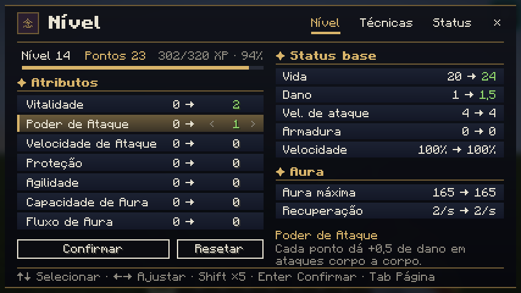
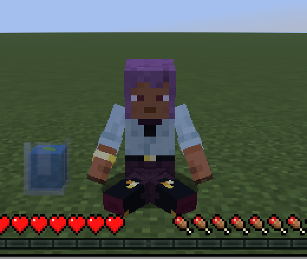
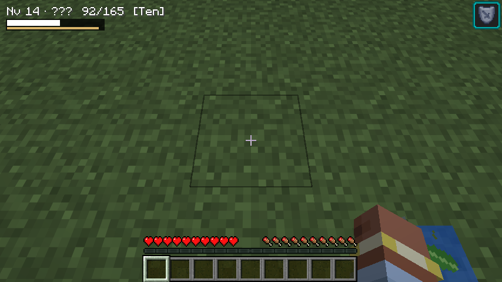
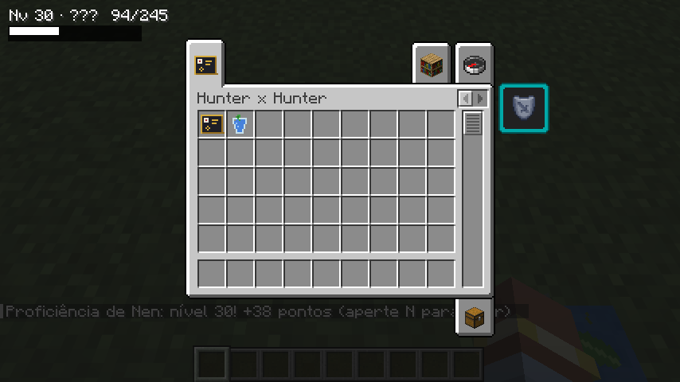
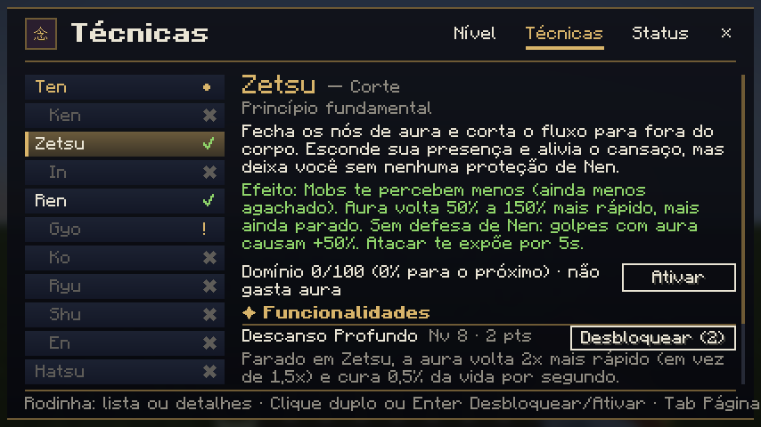
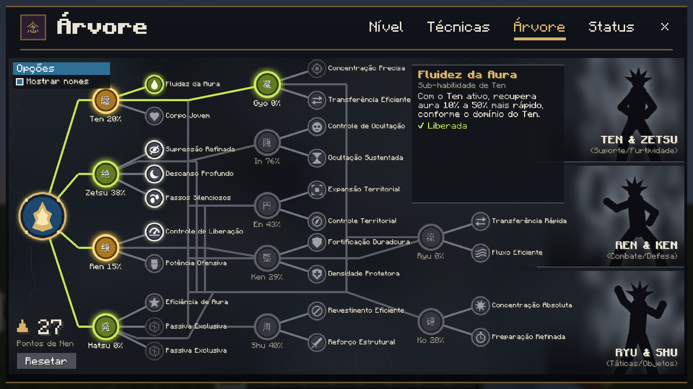
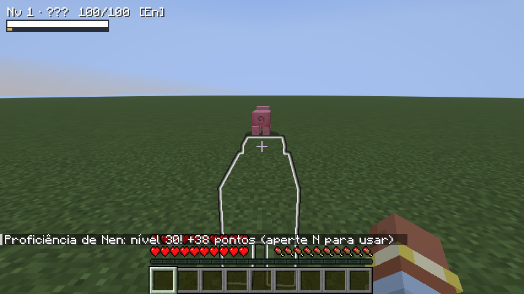

# Hunter x Hunter Mod

Fan mod de Hunter x Hunter para Minecraft **26.3** (Fabric).



## Como funciona o Nen

1. **Despertar:** fique parado no chão agachado (ou com o painel do Nen aberto) para meditar. Depois de 60 segundos sua aura desperta e você aprende os quatro princípios: **Ten, Zetsu, Ren e Hatsu**.
2. **Painel do Nen:** aperte **N** (dá para trocar em Opções > Controles > Hunter x Hunter).
3. **Nível de Nen (1 a 100):** cada segundo com uma técnica ativa dá XP de Nen. Cada nível dá 2 pontos, e a cada 10 níveis você ganha +3 de bônus.
4. **Pontos:** gaste em **atributos** (vida, dano, velocidade de ataque, proteção, agilidade, capacidade e fluxo de aura) ou nas **funcionalidades** de cada técnica. As técnicas não custam pontos: são aprendidas pela proficiência (veja abaixo). Os atributos e os bônus das técnicas são **status internos do personagem**: não mexem na armadura, na vida máxima nem em outros atributos do Minecraft (os corações extras aparecem normalmente na barra de vida).
5. **Vidência (Copo d'Água com Folha):** com o Ren, coloque o copo no chão e clique nele com a mão vazia: o personagem senta e se concentra por 5 segundos (não ande nem se afaste). Também dá para segurar o botão direito com o copo na mão. Cada sessão gasta aura e avança a leitura até revelar seu tipo de Nen.
6. **Meditação:** com o painel aberto, meditando para despertar ou concentrado no copo, o personagem senta de pernas cruzadas.

Todos os itens do mod ficam na aba **Hunter x Hunter** do inventário do criativo.

| Meditação | Copo no chão | Aba do criativo |
|---|---|---|
|  |  |  |

### O painel

| Aba | O que tem |
|---|---|
| **Nível** | Nível, pontos, XP para o próximo nível, distribuição de atributos (atual → novo) e status base |
| **Técnicas** | Uma aba para cada técnica, com o que ela é, o que faz no jogo, proficiência ou requisitos, botão de ativar e funcionalidades para desbloquear |
| **Árvore** | Ocupa a tela toda: emblema do Nen, técnicas e sub-habilidades ligadas pelos requisitos, com a proficiência de cada técnica (nas que faltam aprender, quanto dos requisitos já foi cumprido). Passe o mouse para ver os detalhes, clique numa sub-habilidade para comprar e numa técnica para abrir. Tem "Mostrar nomes" e "Resetar", que devolve os pontos das sub-habilidades compradas |
| **Status** | Registro do treino: tipo, vidência, XP total, pontos e tempo treinado em cada técnica |

Mouse: clique seleciona e aperta os botões, a rodinha em cima de um atributo põe pontos (Shift = 5), o botão direito tira 1 ponto e clique duplo numa técnica liga/desliga.

Teclado: ↑↓ seleciona, ←→ ajusta (Shift = 5 por vez), Enter confirma, Tab troca de aba.





### Técnicas

Várias técnicas podem ficar ligadas ao mesmo tempo (o gasto de aura soma). A exceção é o **Zetsu**: ligar o Zetsu desliga as outras, e ligar qualquer outra encerra o Zetsu.

Cada técnica tem sua tecla de atalho (dá para trocar em Opções > Controles > Hunter x Hunter):

| Ten | Zetsu | Ren | Hatsu | Ken | Gyo | In | Ko | Ryu | Shu | En |
|---|---|---|---|---|---|---|---|---|---|---|
| Z | V | R | U | K | G | I | B | Y | H | J |

**Proficiência (0% a 100%):** cada técnica tem a sua, que sobe com o tempo em que ela fica ligada (mais rápido usando do jeito certo: Ten levando golpes, Zetsu parado). Os quatro princípios vêm ao despertar; as outras técnicas são aprendidas **sozinhas e de graça** quando a proficiência nas técnicas base chega no mínimo pedido.

Os quatro princípios e as aplicações avançadas, seguindo a [wiki de Hunter x Hunter](https://hunter-x-hunter.fandom.com/pt/wiki/Nen):

| Técnica | Aprende com | Efeito no jogo |
|---|---|---|
| **Ten** (Envoltura) | despertar | Reduz o dano de 10% a 25% conforme a proficiência |
| **Zetsu** (Corte) | despertar | Mobs percebem menos você, aura volta mais rápido (mais ainda parado), mas sem defesa de Nen |
| **Ren** (Prática) | despertar | +25% de dano corpo a corpo |
| **Hatsu** (Liberação) | despertar | Treina a aura do seu tipo (a habilidade especial vem em breve) |
| **Gyo** (Coagular) | Ten 20% | Visão noturna e revela invisíveis |
| **In** (Ocultar) | Zetsu 50% | Invisibilidade e +15% de dano corpo a corpo |
| **En** (Território) | Ten 40% + Ren 40% | Detecta toda criatura numa área de 5x5 (1%) até 20x20 (100%), mesmo invisível; só você vê o contorno |
| **Shu** (Ciclo) | Ten 50% | Quebra blocos 60% mais rápido |
| **Ken** (Fortificar) | Ten 60% + Ren 60% | -30% de dano recebido (-45% com Densidade Protetora) |
| **Ko** (Endurecimento) | Gyo, Ten, Zetsu, Ren e Hatsu 70% | +80% de dano, mas recebe +50% de dano e fica 15% mais lento |
| **Ryu** (Fluxo) | Gyo 40% + Ken 40% | +35% de dano, -25% de dano recebido e +10% de velocidade |



### Sub-habilidades

Compradas com pontos na aba Árvore, com os nomes do documento de design. "Em breve" aparece na árvore, mas ainda não pode ser comprada.

| Técnica | Sub-habilidades |
|---|---|
| **Ten** | Fluidez da Aura, Corpo Jovem |
| **Zetsu** | Supressão Refinada, Descanso Profundo, Passos Silenciosos |
| **Ren** | Controle de Liberação, Potência Ofensiva |
| **Hatsu** | Eficiência de Aura (-5% no gasto de aura), duas passivas exclusivas do tipo (em breve) |
| **Gyo** | Concentração Precisa (em breve), Transferência Eficiente |
| **In** | Controle de Ocultação, Ocultação Sustentada |
| **En** | Expansão Territorial, Controle Territorial |
| **Ken** | Fortificação Duradoura, Densidade Protetora |
| **Shu** | Revestimento Eficiente, Reforço Estrutural |
| **Ko** | Concentração Absoluta, Preparação Refinada |
| **Ryu** | Transferência Rápida, Fluxo Eficiente |

### Comandos

`/nen` mostra seu status. Os outros precisam de operador (no mundo single player, ative "Permitir comandos"). Aperte Tab para ver os nomes das técnicas e funcionalidades.

| Comando | O que faz |
|---|---|
| `/nen unlock <técnica\|funcionalidade\|all>` | Libera na hora, mesmo sem a proficiência (junto com as técnicas base) |
| `/nen lock <técnica\|funcionalidade\|all>` | Bloqueia de novo e não deixa ser aprendida sozinha até usar o unlock; funcionalidades pagas devolvem os pontos |
| `/nen level <1-100>` | Vai direto para o nível |
| `/nen xp <quantidade>` | Dá XP de Nen |
| `/nen points add <quantidade>` | Pontos extras para gastar no painel (negativo tira) |
| `/nen stats reset` | Zera os atributos e devolve os pontos |
| `/nen awaken [tipo]` | Desperta na hora; com o tipo, troca o tipo de Nen |
| `/nen reveal` | Revela o tipo sem o copo |
| `/nen aura` | Enche a aura |
| `/nen reset` | Apaga todo o Nen e recomeça do zero |

Exemplos: `/nen unlock ken`, `/nen lock zetsu`, `/nen unlock ryu_master`, `/nen awaken emission`.

Os números de balanceamento ficam em `src/main/java/com/hxhmod/nen/NenRules.java`, `NenStat.java`, `Technique.java` e `NenUpgrade.java`.

## Compilar

Precisa do Java 25.

```bash
./gradlew build
```

O `.jar` sai em `build/libs/`. O comando `./gradlew installMod` compila e copia direto para a pasta `mods` da instância.

`./gradlew runClientGameTest` abre o jogo sozinho, testa o painel e salva prints em `build/run/clientGameTest/screenshots`.

## Aviso

Projeto de fã, sem fins lucrativos. Hunter x Hunter pertence a Yoshihiro Togashi e Shueisha. Todas as texturas do mod são originais.
